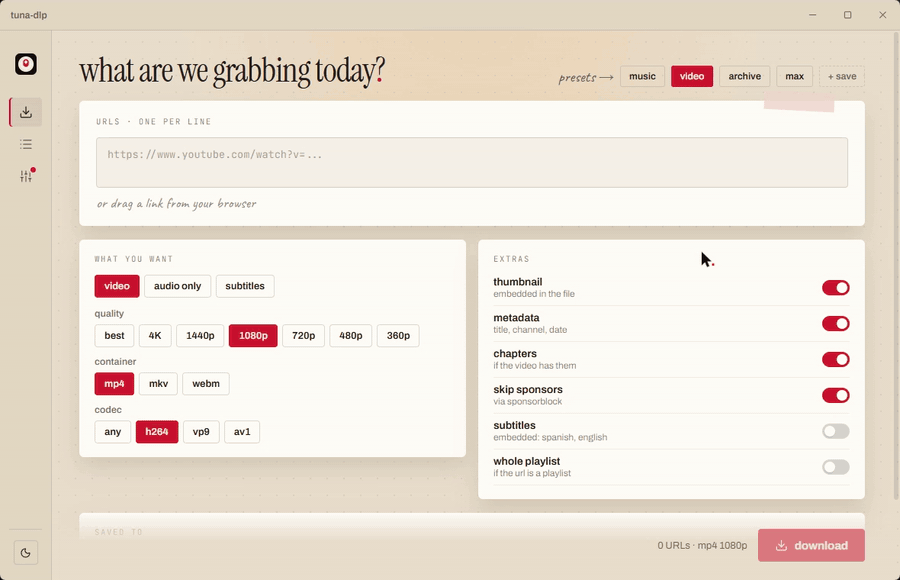
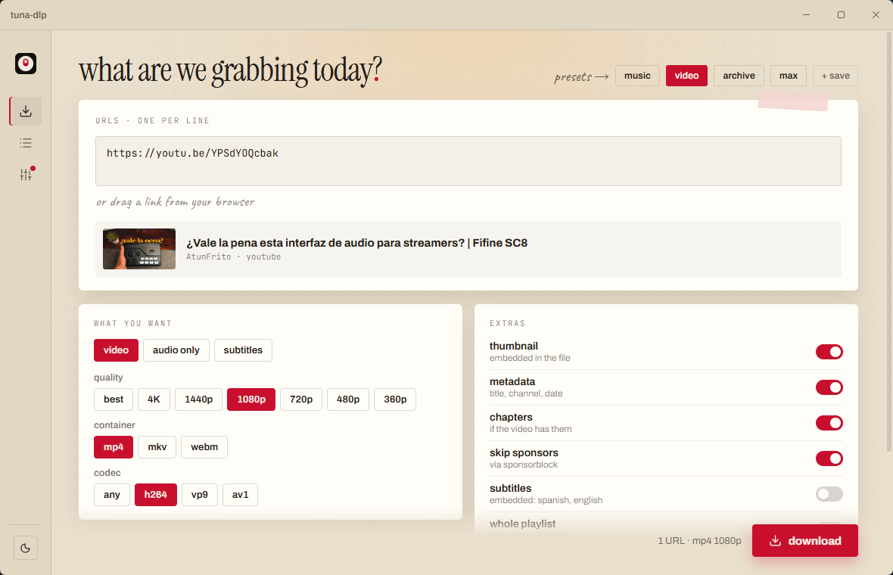
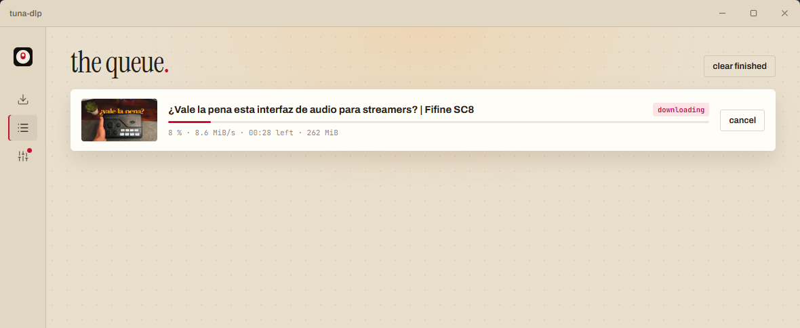
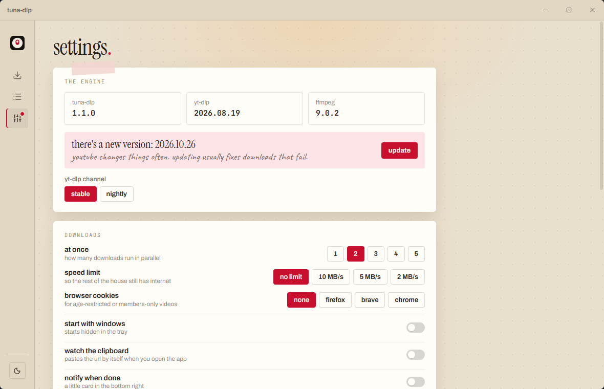
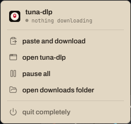
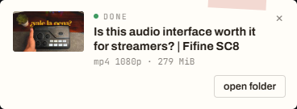

<p align="center"><b>English</b> · <a href="README.es.md">Español</a></p>

<p align="center">
  
</p>

<h1 align="center">tuna-dlp</h1>

<p align="center"><b>A simple Windows GUI for yt-dlp and ffmpeg.</b></p>

<p align="center">
  <a href="https://github.com/atunfrito/tuna-dlp/releases/latest">Download</a> ·
  <a href="#building-from-source">Build from source</a>
</p>

---

tuna-dlp is **not** a new downloader. All the real work is done by
[yt-dlp](https://github.com/yt-dlp/yt-dlp) and [ffmpeg](https://ffmpeg.org);
tuna-dlp just puts buttons on top of them, so you can paste a link, pick what you
want and press *download*.

It's made for people who don't want to open a terminal or learn yt-dlp's options.
If you're comfortable with the command line, yt-dlp on its own will serve you better.

The interface is in **English and Spanish**: it follows your Windows language, and
you can switch it in the settings.

<p align="center">
  
</p>

## Screenshots



| Queue | Settings |
| --- | --- |
|  |  |
| **Tray menu** | **Notification when a download finishes** |
|  |  |

## Features

Everything below is in the app today.

**Downloading**
- Paste one or more URLs (one per line), or drag a link from your browser onto the window.
- Optionally picks up a URL from the clipboard when you open the app.
- Preview with thumbnail, title and channel before downloading.
- **Video:** quality (best, 4K, 1440p, 1080p, 720p, 480p, 360p), container (mp4, mkv, webm) and codec (any, h264, vp9, av1).
- **Audio only:** mp3, m4a, opus, flac, wav or vorbis, with a bitrate choice.
- **Subtitles only**, with a language picker that shows which languages the video actually has (uploaded by the author or automatic).
- Extras: embed thumbnail, metadata and chapters, skip sponsor segments with SponsorBlock, embed subtitles.
- Playlists: preview the list and tick which videos to download.
- Built-in presets (music, video, archive, max) and your own saved presets.
- The real format is shown when a download finishes (e.g. *mp4 240p* if that's all the video had).

**Queue**
- 1–5 downloads in parallel, with progress, speed and time left.
- Cancel, retry, pause all / resume all (resumes from the partial file).
- Progress on the taskbar icon: green, yellow when paused, red on error.

**Optional features** (off by default, turn them on in the settings)
- Show the yt-dlp command being run.
- Trim videos (from minute X to minute Y).
- File name template with a live preview.
- Download history with search.
- Channel subscriptions: follow a channel and download only new videos, also when the app opens.

**Windows integration**
- Closing the window keeps it in the system tray; downloads carry on.
- Tray menu: status, paste and download, pause/resume, open the downloads folder, quit.
- Optional start with Windows, hidden in the tray.
- Its own notifications when something finishes.
- Light, dark or system theme. English or Spanish.

**Settings**
- Download folder, speed limit, and cookies from your browser (Firefox, Brave, Chrome) for age-restricted or members-only videos.
- "Don't download twice" archive.
- Check for and install yt-dlp updates from inside the app (stable or nightly channel).

yt-dlp and ffmpeg are **bundled inside the .exe**, so there's nothing else to install.

## Installation

1. Go to [Releases](https://github.com/atunfrito/tuna-dlp/releases/latest).
2. Download `tuna-dlp_x.y.z_x64-setup.exe` and run it. It installs for your user only, no admin rights needed.

There's also a portable version, `tuna-dlp_x.y.z_x64-portable.zip`: unzip it and run
`tuna-dlp.exe`, no install needed (settings are still stored in your user profile).

> **Windows SmartScreen:** the app isn't code-signed (certificates cost money), so
> Windows may show *"Windows protected your PC"* the first time. Click
> **More info → Run anyway**. If you'd rather not trust a random .exe, you can
> [build it yourself](#building-from-source).

Requirements: Windows 10 or 11 (64-bit) with WebView2, which comes with Windows 11
and up-to-date Windows 10. The installer downloads it if it's missing.

## Building from source

You need:
- [Node.js](https://nodejs.org) 20 or newer
- [Rust](https://rustup.rs) (stable, MSVC toolchain) and the
  [Tauri prerequisites for Windows](https://tauri.app/start/prerequisites/)

```powershell
git clone https://github.com/atunfrito/tuna-dlp.git
cd tuna-dlp
npm install

# Downloads yt-dlp.exe, ffmpeg.exe and ffprobe.exe into src-tauri/bin
# and checks their SHA-256. They're not in the repo.
powershell -ExecutionPolicy Bypass -File scripts/binarios.ps1

npm run dev          # run in development
npm run build        # portable .exe in src-tauri/target/release
npm run instalador   # installer in src-tauri/target/release/bundle/nsis
```

The first build is slow: `build.rs` compresses the ~230 MB of yt-dlp and ffmpeg
with zstd so they fit inside the .exe. On first run the app extracts them to
`%LOCALAPPDATA%\es.atunfrito.tunadlp\bin`.

Made with [Tauri 2](https://tauri.app), [Svelte 5](https://svelte.dev) and Rust. The
code and its comments are in Spanish; all the interface text lives in
[`src/lib/textos.js`](src/lib/textos.js).

## Problems I ran into (and how they're solved)

- **Titles with "…" or curly quotes broke downloads (`Errno 22`).** The yt-dlp.exe
  build writes in the console's code page (cp1252) when it has no real console.
  tuna-dlp always runs it with `--encoding utf-8`, `PYTHONUTF8=1`,
  `PYTHONIOENCODING=utf-8`, stdin set to null, `--windows-filenames`, and the
  folder passed with `-P` instead of inside `-o`. Arguments are passed as an array,
  never through a shell.
- **Trimming with `--download-sections` produced broken files.** tuna-dlp
  downloads the whole video and cuts it with ffmpeg afterwards. If the start lands
  on a keyframe it just copies the streams; if not, it re-encodes so the cut is exact.
- **Console windows popping up.** Every process (yt-dlp, ffmpeg, ffprobe) is
  started with `CREATE_NO_WINDOW`.
- **Dragging links from the browser didn't work** (and the "drop it here" overlay
  got stuck): Tauri's drag and drop handler only understands files. It's turned off,
  so WebView2 hands the link to the page.
- **The taskbar progress bar was grey** on Windows 11, because it uses the system
  accent colour. tuna-dlp draws its own bar on the taskbar icon.
- **The tray menu.** The native Windows menu can't be styled, so it's a small
  window that doesn't steal focus (otherwise the hidden-icons flyout closes) and
  closes on a click outside, on Esc, or when the flyout goes away.
- **If the app closed unexpectedly** there was no trace, so everything is logged
  to `%LOCALAPPDATA%\es.atunfrito.tunadlp\logs\tuna-dlp.log`.

## Credits and licenses

tuna-dlp itself is released under the [MIT License](LICENSE). The full list of
third-party software, with versions, licenses and where to get the source code, is
in [THIRD-PARTY-NOTICES.md](THIRD-PARTY-NOTICES.md); the license texts are in
[`licenses/`](licenses).

It bundles and runs these programs, which keep their own licenses:

- **[yt-dlp](https://github.com/yt-dlp/yt-dlp)**: [Unlicense](https://github.com/yt-dlp/yt-dlp/blob/master/LICENSE).
  The official `yt-dlp.exe` from the latest yt-dlp release at build time. It can be
  updated from inside the app.
- **[FFmpeg](https://ffmpeg.org)** (`ffmpeg.exe` and `ffprobe.exe`): the
  *release essentials* build by [gyan.dev](https://www.gyan.dev/ffmpeg/builds/)
  (FFmpeg 9.0.2). It's built with `--enable-gpl --enable-version3`, so it's licensed
  under the **GPL v3**. FFmpeg's source code is at
  [ffmpeg.org/download.html](https://ffmpeg.org/download.html), and gyan.dev lists the
  exact configuration and libraries of each build. tuna-dlp doesn't modify FFmpeg;
  it only runs it as a separate program.

Also used: [Tauri](https://tauri.app) (MIT/Apache-2.0), [Svelte](https://svelte.dev)
(MIT), [Lucide](https://lucide.dev) icons (ISC), and the fonts Instrument Serif,
Archivo, JetBrains Mono and Caveat (SIL Open Font License).

tuna-dlp is not affiliated with yt-dlp, FFmpeg, YouTube or any other site. Download
only what you have the right to download.

Made by [atunfrito](https://atunfrito.es).
