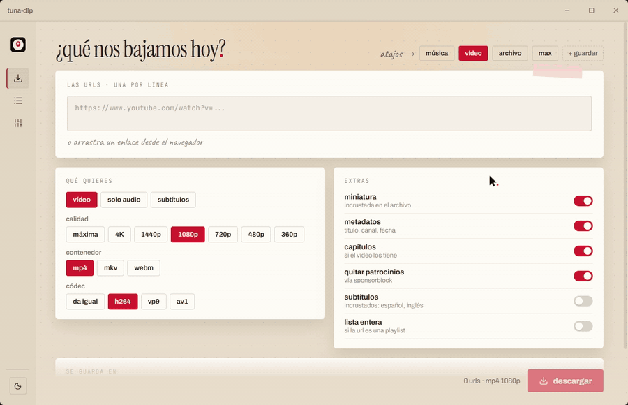
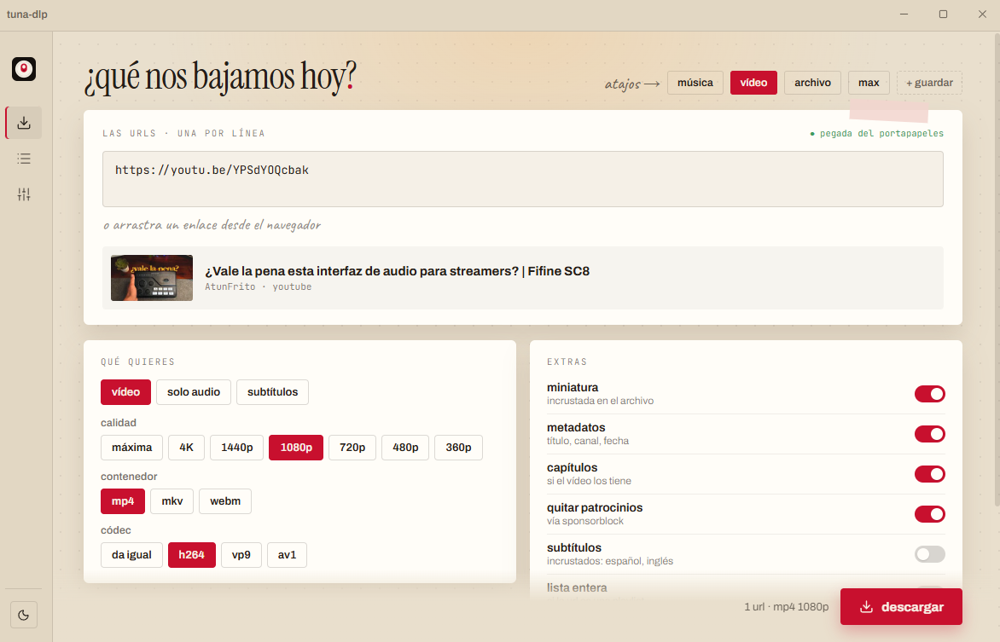
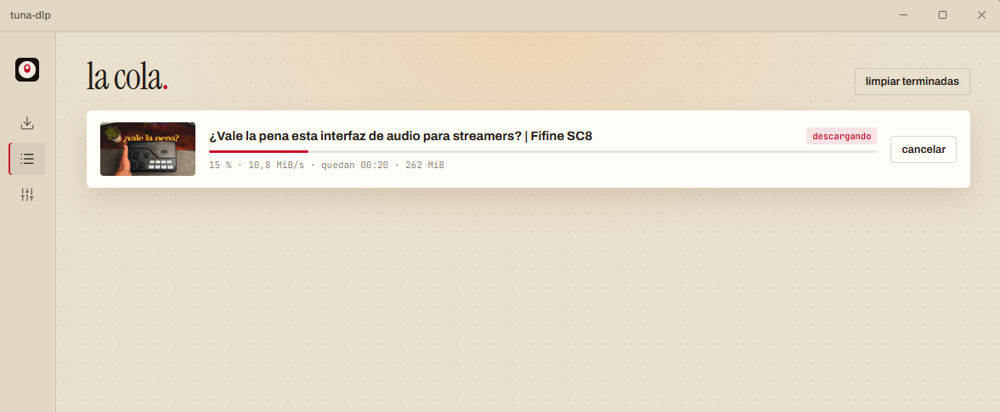
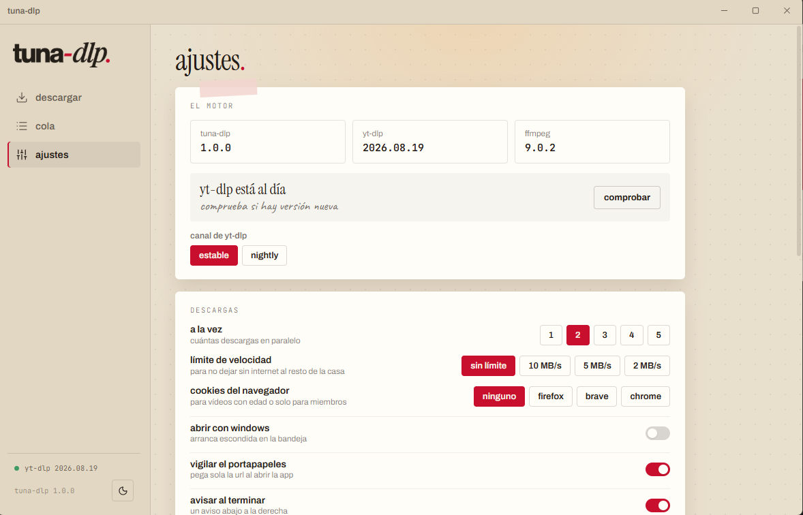
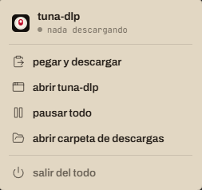

<p align="center">
  
</p>

<h1 align="center">tuna-dlp</h1>

<p align="center"><b>Una interfaz sencilla para Windows que usa yt-dlp y ffmpeg.</b></p>

<p align="center">
  <a href="https://github.com/atunfrito/tuna-dlp/releases/latest">Descargar</a> ·
  <a href="#compilarlo-desde-el-código">Compilarlo</a> ·
  <a href="#in-english">In English</a>
</p>

---

tuna-dlp **no** es un descargador nuevo. Todo el trabajo de verdad lo hacen
[yt-dlp](https://github.com/yt-dlp/yt-dlp) y [ffmpeg](https://ffmpeg.org);
tuna-dlp solo les pone botones encima, para que pegues un enlace, elijas qué
quieres y le des a *descargar*.

Está pensado para quien no quiere abrir una terminal ni aprenderse las opciones
de yt-dlp. Si te manejas con la línea de comandos, yt-dlp a secas te servirá mejor.

<p align="center">
  
</p>

## Capturas

| Descargar | Cola |
| --- | --- |
|  |  |
| **Ajustes** | **Menú de la bandeja** |
|  |  |

## Qué hace

Todo lo de esta lista está en la app hoy.

**Descargar**
- Pega una o varias URLs (una por línea), o arrastra un enlace desde el navegador a la ventana.
- Si quieres, coge sola la URL del portapapeles al abrir la app.
- Vista previa con miniatura, título y canal antes de descargar.
- **Vídeo:** calidad (máxima, 4K, 1440p, 1080p, 720p, 480p, 360p), contenedor (mp4, mkv, webm) y códec (da igual, h264, vp9, av1).
- **Solo audio:** mp3, m4a, opus, flac, wav o vorbis, eligiendo el bitrate.
- **Solo subtítulos**, con un selector que enseña qué idiomas tiene de verdad el vídeo (subidos por el autor o automáticos).
- Extras: incrustar miniatura, metadatos y capítulos, quitar los patrocinios con SponsorBlock, incrustar subtítulos.
- Listas de reproducción: ves la lista y marcas qué vídeos bajar.
- Atajos (música, vídeo, archivo, max) y tus propios presets guardados.
- Al terminar enseña el formato real (por ejemplo *mp4 240p* si el vídeo no tenía más).

**La cola**
- De 1 a 5 descargas a la vez, con progreso, velocidad y tiempo restante.
- Cancelar, reintentar, pausar todo y reanudar (sigue desde el archivo a medias).
- Progreso en el icono de la barra de tareas: verde, amarillo en pausa, rojo si falla.

**Funciones opcionales** (apagadas por defecto; se encienden en ajustes)
- Ver el comando de yt-dlp que se ejecuta.
- Recortar vídeos (de tal minuto a tal otro).
- Plantilla para el nombre de los archivos, con vista previa.
- Historial de descargas con buscador.
- Suscripciones a canales: sigues un canal y baja solo lo nuevo, también al abrir la app.

**Integración con Windows**
- Cerrar la ventana la deja en la bandeja del sistema y las descargas siguen.
- Menú de la bandeja: estado, pegar y descargar, pausar o reanudar, abrir la carpeta de descargas, salir.
- Puede arrancar con Windows, escondida en la bandeja.
- Avisos propios cuando algo termina.
- Tema claro, oscuro o el del sistema.

**Ajustes**
- Carpeta de descargas, límite de velocidad y cookies del navegador (Firefox, Brave, Chrome) para vídeos con límite de edad o solo para miembros.
- Registro para no bajar dos veces lo mismo.
- Comprobar e instalar actualizaciones de yt-dlp desde la app (canal estable o nightly).

yt-dlp y ffmpeg **van dentro del .exe**, así que no hay que instalar nada más.

## Instalación

1. Entra en [Releases](https://github.com/atunfrito/tuna-dlp/releases/latest).
2. Descarga `tuna-dlp_x.y.z_x64-setup.exe` y ábrelo. Se instala solo para tu usuario, sin pedir permisos de administrador.

También hay una versión portable, `tuna-dlp_x.y.z_x64-portable.zip`: descomprímela
y abre `tuna-dlp.exe`, sin instalar nada (los ajustes se guardan igualmente en tu
perfil de usuario).

> **Windows SmartScreen:** la app no está firmada (los certificados cuestan dinero),
> así que la primera vez Windows puede decir *"Windows protegió su PC"*. Pulsa
> **Más información → Ejecutar de todas formas**. Si prefieres no fiarte de un .exe
> cualquiera, puedes [compilarlo tú](#compilarlo-desde-el-código).

Hace falta Windows 10 u 11 de 64 bits con WebView2, que viene de serie en Windows 11
y en los Windows 10 actualizados. Si falta, el instalador lo descarga.

## Compilarlo desde el código

Necesitas:
- [Node.js](https://nodejs.org) 20 o más nuevo
- [Rust](https://rustup.rs) (estable, con el toolchain MSVC) y los
  [requisitos de Tauri para Windows](https://tauri.app/start/prerequisites/)

```powershell
git clone https://github.com/atunfrito/tuna-dlp.git
cd tuna-dlp
npm install

# Descarga yt-dlp.exe, ffmpeg.exe y ffprobe.exe en src-tauri/bin
# y comprueba su SHA-256. No están en el repo.
powershell -ExecutionPolicy Bypass -File scripts/binarios.ps1

npm run dev          # en modo desarrollo
npm run build        # .exe portable en src-tauri/target/release
npm run instalador   # instalador en src-tauri/target/release/bundle/nsis
```

La primera compilación es lenta: `build.rs` comprime con zstd los ~230 MB de
yt-dlp y ffmpeg para meterlos en el .exe. La primera vez que se abre, la app los
extrae en `%LOCALAPPDATA%\es.atunfrito.tunadlp\bin`.

Hecho con [Tauri 2](https://tauri.app), [Svelte 5](https://svelte.dev) y Rust.

## Problemas que me encontré (y cómo están resueltos)

- **Los títulos con "…" o comillas curvas rompían la descarga (`Errno 22`).** El
  yt-dlp.exe escribe en la página de códigos de la consola (cp1252) cuando no tiene
  una de verdad. tuna-dlp siempre lo lanza con `--encoding utf-8`, `PYTHONUTF8=1`,
  `PYTHONIOENCODING=utf-8`, la entrada estándar a null, `--windows-filenames` y la
  carpeta en `-P` en vez de dentro de `-o`. Los argumentos van como lista, nunca
  a través de una shell.
- **Recortar con `--download-sections` daba archivos rotos.** tuna-dlp baja el vídeo
  entero y luego lo corta con ffmpeg. Si el inicio cae en un fotograma clave, solo
  copia; si no, recodifica para que el corte sea exacto.
- **Ventanas de consola que aparecían y desaparecían.** Todos los procesos (yt-dlp,
  ffmpeg, ffprobe) se lanzan con `CREATE_NO_WINDOW`.
- **Arrastrar enlaces desde el navegador no funcionaba** (y el aviso de "suéltalo
  aquí" se quedaba pegado): el manejador de arrastrar y soltar de Tauri solo entiende
  archivos. Está apagado, y así WebView2 le pasa el enlace a la página.
- **La barra de progreso de la barra de tareas salía gris** en Windows 11, porque
  usa el color de énfasis del sistema. tuna-dlp pinta su propia barra sobre el icono.
- **El menú de la bandeja.** El menú nativo de Windows no se puede personalizar,
  así que es una ventanita que no roba el foco (si lo hiciera, se cerraría el
  desplegable de iconos ocultos) y se cierra con un clic fuera, con Esc o cuando
  se cierra ese desplegable.
- **Si la app se cerraba sola no quedaba rastro**, así que todo queda apuntado en
  `%LOCALAPPDATA%\es.atunfrito.tunadlp\logs\tuna-dlp.log`.

## Créditos y licencias

tuna-dlp se publica con [licencia MIT](LICENSE). La lista completa de software de
terceros, con versiones, licencias y dónde está su código fuente, está en
[THIRD-PARTY-NOTICES.md](THIRD-PARTY-NOTICES.md), y los textos de las licencias en
[`licenses/`](licenses).

Incluye y ejecuta estos programas, que mantienen sus propias licencias:

- **[yt-dlp](https://github.com/yt-dlp/yt-dlp)**: [Unlicense](https://github.com/yt-dlp/yt-dlp/blob/master/LICENSE).
  Es el `yt-dlp.exe` oficial de la última versión publicada al compilar, y se puede
  actualizar desde la propia app.
- **[FFmpeg](https://ffmpeg.org)** (`ffmpeg.exe` y `ffprobe.exe`): el build
  *release essentials* de [gyan.dev](https://www.gyan.dev/ffmpeg/builds/)
  (FFmpeg 9.0.2 en la v1.0.0). Está compilado con `--enable-gpl --enable-version3`,
  así que su licencia es **GPL v3**. El código fuente de FFmpeg está en
  [ffmpeg.org/download.html](https://ffmpeg.org/download.html), y gyan.dev publica
  la configuración y las librerías exactas de cada build. tuna-dlp no modifica
  FFmpeg: solo lo ejecuta como un programa aparte.

También usa [Tauri](https://tauri.app) (MIT/Apache-2.0), [Svelte](https://svelte.dev)
(MIT), los iconos de [Lucide](https://lucide.dev) (ISC) y las fuentes Instrument
Serif, Archivo, JetBrains Mono y Caveat (SIL Open Font License).

tuna-dlp no tiene relación con yt-dlp, FFmpeg, YouTube ni ninguna otra web. Descarga
solo lo que tengas derecho a descargar.

Hecho por [atunfrito](https://atunfrito.es).

---

## In English

**tuna-dlp** is a simple Windows GUI for **yt-dlp** and **ffmpeg**, for people who
don't want to use the terminal. It's not a new downloader: yt-dlp and ffmpeg do all
the work, and both are bundled inside the .exe. **The interface is in Spanish only.**

- **Install:** get the `-setup.exe` from [Releases](https://github.com/atunfrito/tuna-dlp/releases/latest).
  It isn't code-signed, so Windows SmartScreen may warn you: *More info → Run anyway*.
- **Build:** see [Compilarlo desde el código](#compilarlo-desde-el-código) (the commands are the same).
- **License:** MIT. yt-dlp is Unlicense; the bundled ffmpeg (gyan.dev build) is GPL v3.
